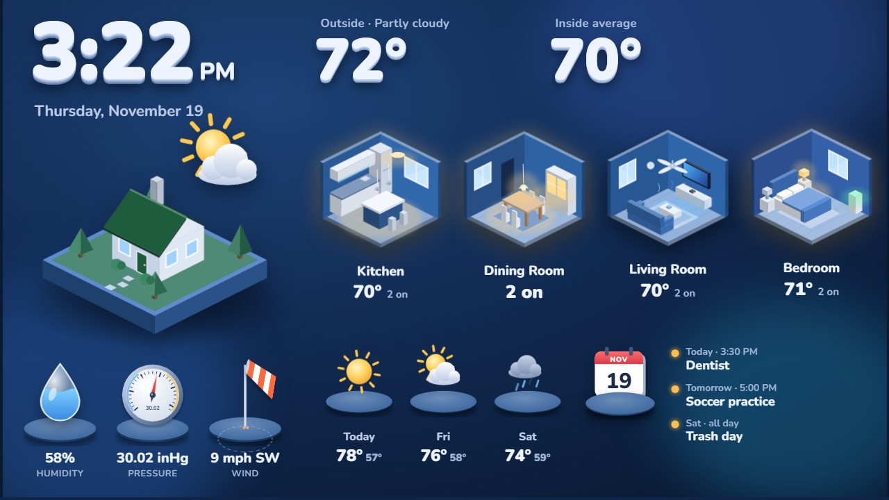
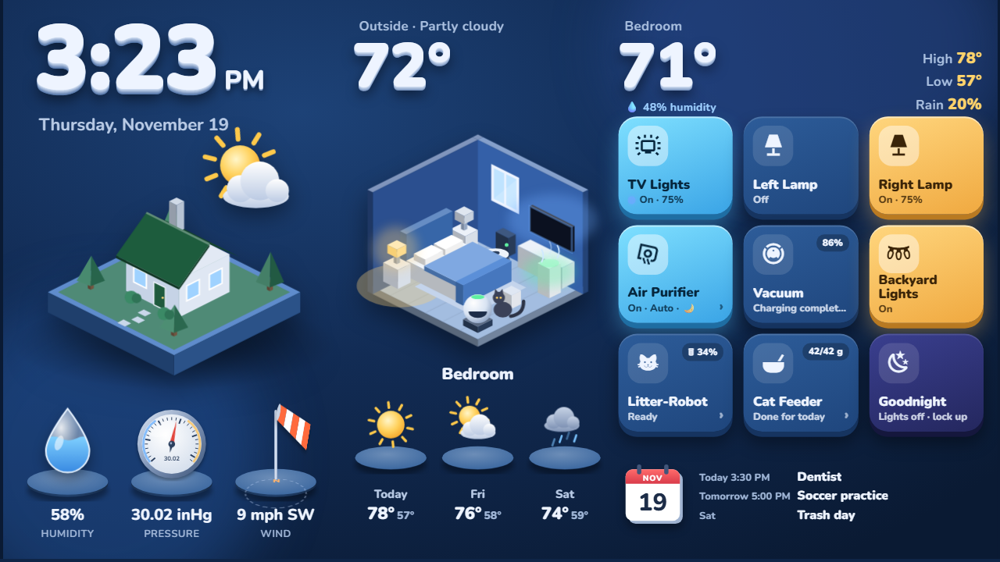
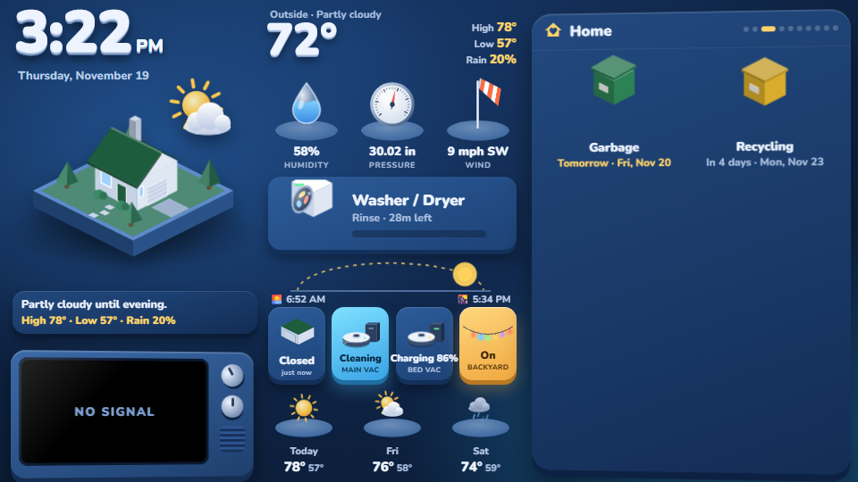
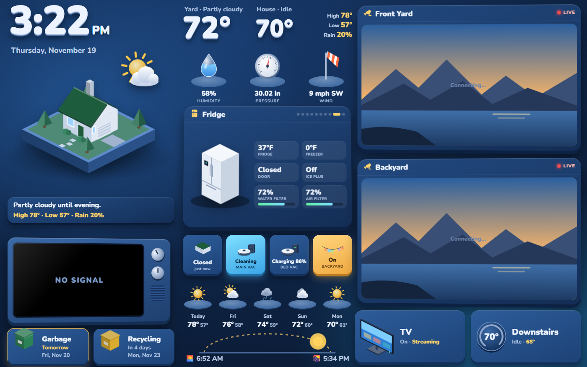
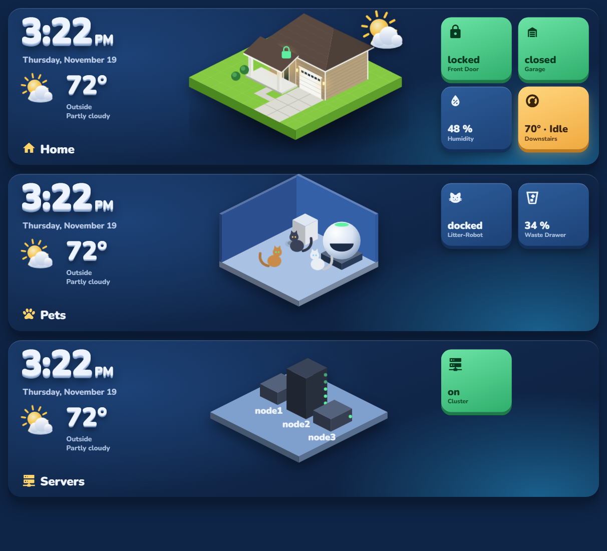
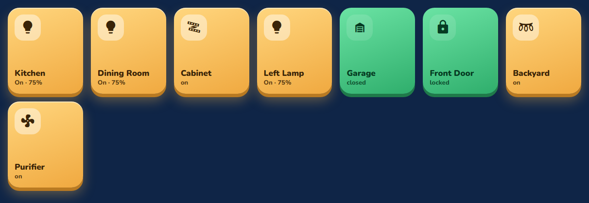

# 3D Dashboards for Home Assistant

Animated, isometric "3D" dashboard cards for Home Assistant, in a deep-blue style. Each card is a single JavaScript file with no build step and no dependencies. They draw everything in SVG and CSS, and scale to fit any screen.

They were built for always-on screens: a Nest Hub in the kitchen, a Fire TV in the living room, a monitor in the garage, and a tablet in the bedroom. They work just as well in a normal browser dashboard.

There's also a matching skin for the [Glance](https://github.com/glanceapp/glance) start page.

| | |
|---|---|
|  |  |
| **[Home 3D](docs/home3d-card.md)**: clock, weather house, gauges, 4 tappable 3D rooms, forecast, calendar | **[Bedroom 3D](docs/bedroom3d-card.md)**: 3D bedroom scene and 9 touch tiles (lamps, purifier, vacuum, litter box, feeder) |
|  |  |
| **[TV 3D](docs/tv3d-card.md)**: display-only TV screen with a rotating right panel (photos, cameras, bins, mower, vacuums) | **[Garage 3D](docs/garage3d-card.md)**: wall monitor with two live cameras, fridge/washer/vacuum panel, bins and garage door |
|  |  |
| **[Room 3D hero](docs/room3d.md)**: a banner for the top of any dashboard page, with 11 scenes | **[Room 3D tiles](docs/room3d.md#room3d-tiles)**: big 3D touch tiles for lights, switches, locks and covers |

*Screenshots use made-up demo data.*

## What's in the repo

| File | Card type(s) | Canvas |
|---|---|---|
| [`cards/home3d-card.js`](cards/home3d-card.js) | `custom:home3d-card` | 1280×720 |
| [`cards/bedroom3d-card.js`](cards/bedroom3d-card.js) | `custom:bedroom3d-card` | 1280×720 |
| [`cards/tv3d-card.js`](cards/tv3d-card.js) | `custom:tv3d-card` | 960×540 |
| [`cards/garage3d-card.js`](cards/garage3d-card.js) | `custom:garage3d-card` | 1400×875 |
| [`cards/room3d.js`](cards/room3d.js) | `custom:room3d-hero`, `custom:room3d-tiles` | fits the column |
| [`glance/user.css`](glance/user.css) | Glance skin | [docs](docs/glance.md) |
| [`examples/`](examples) | Ready-to-edit YAML for every card, plus helper automations | |
| [`demo/`](demo) | Preview any card in a browser with fake data | |

## Install

The same steps apply to every card.

1. Copy the file from `cards/` into your Home Assistant `/config/www/` folder (for example with the File editor or Samba add-on).
2. Go to **Settings → Dashboards → ⋮ → Resources → Add resource**:
   - URL: `/local/home3d-card.js` (use the file's name)
   - Type: **JavaScript module**
3. Add the card to a dashboard in YAML mode, for example `type: custom:home3d-card`. See each card's page for its options, or start from a file in [`examples/`](examples).

The full-screen cards (Home, Bedroom, TV, Garage) look best in a view of type **Panel**, so the card fills the screen. The Room 3D cards are made for **Sections** views.

**After updating a file**, change the resource URL to `...js?v=2` (then `v=3`, and so on) so browsers fetch the new version.

## Using your own entities

Every card has a defaults block at the top of its file listing all its options. **Anything you leave out of your YAML uses that default**, which is a made-up entity such as `vacuum.bedroom_vacuum`. Point each option at your own entity.

If you don't own a device (say, a litter box), you can leave its option alone. That tile or panel just shows "Unavailable" or `--` instead of breaking the card.

## Optional extras

- **Weather.** Any `weather.*` entity works. The "today's high/low/rain chance" and "summary" options expect separate sensors; integrations such as [Pirate Weather](https://github.com/Pirate-Weather/pirate-weather-ha) provide them.
- **Calendars.** Any `calendar.*` entities.
- **Retro TV screen.** The TV and Garage cards draw an old TV set. Set `weatherstar:` to the URL of a self-hosted [WeatherStar 4000+](https://github.com/netbymatt/ws4kp) to play it on that screen. Without it, the screen says "NO SIGNAL".
- **Embedded cards.** The TV card's vacuum and network panels embed other cards (`appliance-robot-vacuum-solo-card`, `silverfox-network-card`). Replace them with any cards you like using the `embeds:` option.

## Preview without Home Assistant

```
cd ha-3d-dashboards
python -m http.server 8765
```

Then open `http://localhost:8765/demo/index.html?card=home`. Other values: `bedroom`, `tv`, `garage`, `hero`, `tiles`. For the TV and Garage cards, add `&panel=camera` (or `photos`, `home`, `mower`, `fridge`, `washer`, ...) to see a specific panel.

## Tips

- **Nest Hub:** cast a view with `cast.show_lovelace_view`. The Hub drops casts after about 10 minutes, so re-cast every 8 minutes from an automation. See [examples/nest-hub-recast.yaml](examples/nest-hub-recast.yaml).
- **Fire TV / Android TV:** [Fully Kiosk Browser](https://www.fully-kiosk.com/) works well. Set the start URL to the dashboard view with `?kiosk` if you use [kiosk-mode](https://github.com/NemesisRE/kiosk-mode).
- **Slow screens:** put a gzipped copy next to the file (`gzip -9 -k home3d-card.js`). Home Assistant serves the `.gz` version automatically. Re-gzip after each edit.
- **Fonts:** the cards load *Nunito* from Google Fonts and fall back to a system font when offline.

## License

[MIT](LICENSE). Use it, change it, share it.
