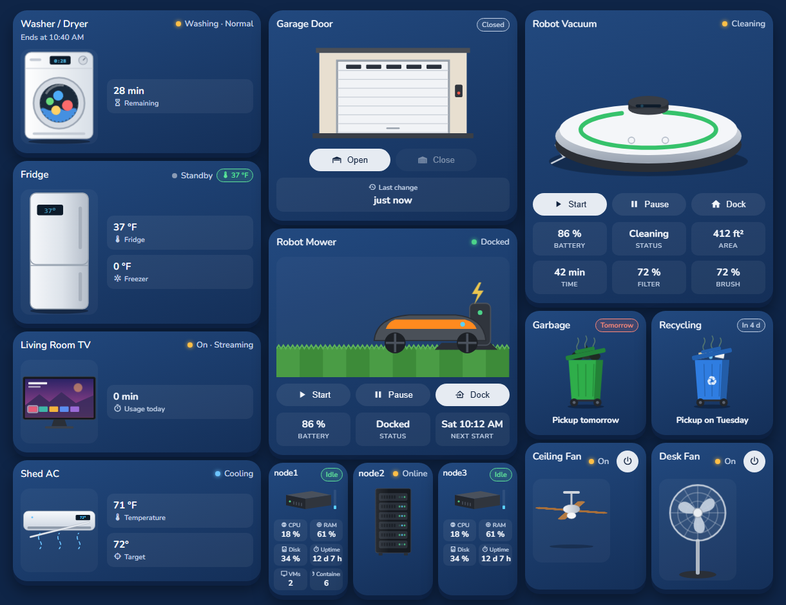

# Appliance & bin cards

`cards/home-appliance-cards.js` is one file with 12 animated cards for everyday devices, in the same deep-blue style as the 3D dashboards.



*Demo data. The washer drum turns, the vacuum's light ring sweeps, the fans spin, and so on.*

## Why

They replace two popular community packages, *Animated Appliance & Energy Cards* and *Poubelle Card*, for people who only use a handful of their cards:

- **No update prompts.** It's one 50 KB file you own.
- **No dependencies or build step.**
- **Same config keys,** so switching over is just a change of `type:` (see [Switching from the community cards](#switching-from-the-community-cards)).

## Install

1. Copy `cards/home-appliance-cards.js` into `/config/www/`.
2. Add it as a resource: URL `/local/home-appliance-cards.js`, type **JavaScript module**.
3. Use the cards below. Every card also appears in the card picker as "Home …".

Tapping a card's picture or tile opens Home Assistant's normal more-info dialog for that entity.

## The cards

### Fridge: `custom:home-fridge-card`

```yaml
type: custom:home-fridge-card
name: Fridge
temperature: number.fridge_temperature              # or a sensor
freezer_temperature: number.freezer_temperature
door: binary_sensor.fridge_door                     # optional
max_temperature: 40                                 # badge turns red above this
temperature_unit: F                                 # used if the entity has no unit
```

- **Display:** the fridge's temperature shows on its little screen.
- **Door open:** it swings open with the light on, and the status turns red.

### Washer / dryer: `custom:home-washer-card`

```yaml
type: custom:home-washer-card
name: Washer / Dryer
entity: sensor.washer_machine_state   # e.g. Run / Idle / Done
program: sensor.washer_cycle          # optional, shown after the status
remaining: sensor.washer_time_remaining   # seconds, minutes or hours (read from the unit)
```

- **Running:** the drum spins with water and clothes inside, and the machine shakes.
- **Time left:** shown on the display, along with an "Ends at 10:18 AM" line.

### TV: `custom:home-tv-card`

```yaml
type: custom:home-tv-card
name: Living Room TV
entity: media_player.living_room_tv
```

- **When on:** the screen lights up with an animated home screen and shows the current source.
- **Usage today:** worked out from the entity's history.

### Ceiling fan: `custom:home-ceiling-fan-card` · Pedestal fan: `custom:home-fan-card`

```yaml
type: custom:home-ceiling-fan-card   # or custom:home-fan-card
name: Living Room Fan
entity: switch.living_room_fan       # switch, fan or light
switch: switch.living_room_fan       # optional: the entity the power button toggles
```

- **When on:** the blades spin, and the pedestal fan also oscillates.
- **Power button:** at the top right.

### Mini-split AC: `custom:home-ac-split-card`

```yaml
type: custom:home-ac-split-card
name: Shed AC
entity: climate.shed_ac
temperature: sensor.shed_temperature   # optional room sensor
```

- **While running:** the vane opens and air flows out. The air is blue for cooling, orange for heating and teal for dry.
- **Target:** shown on the unit's display.

### Garage door: `custom:home-garage-door-card`

```yaml
type: custom:home-garage-door-card
name: Garage Door
entity: cover.garage_door
travel_time: 14        # seconds for a full open or close
show_since: true       # "Last change: 14 min. ago"
```

- **Moving:** the door slides at your door's real speed while it's opening or closing.
- **Buttons:** Open and Close.

### Robot mower: `custom:home-mower-card`

```yaml
type: custom:home-mower-card
name: Robot Mower
entity: lawn_mower.robot_mower
entity_battery: sensor.robot_mower_battery         # optional
entity_next_start: sensor.robot_mower_next_start   # optional timestamp
```

- **Mowing:** drives back and forth with its wheels turning and clippings flying.
- **Docked:** sits at the dock with a charging bolt, or snores "z z" when full or paused.
- **Buttons:** Start, Pause and Dock.

### Robot vacuum: `custom:home-vacuum-card`

```yaml
type: custom:home-vacuum-card
name: Robot Vacuum
entity: vacuum.robot_vacuum
entity_battery: sensor.robot_vacuum_battery     # all the sensors are optional
entity_status: sensor.robot_vacuum_status
entity_area: sensor.robot_vacuum_cleaned_area
entity_time: sensor.robot_vacuum_cleaning_time
entity_filter: sensor.robot_vacuum_filter_left
entity_brush: sensor.robot_vacuum_main_brush_left
```

- **Cleaning:** the light ring sweeps, the robot roams and the side brush spins.
- **Docked:** shows a charging bolt.
- **Buttons:** Start, Pause and Dock.
- **Suction:** shown when the vacuum reports `fan_speed` or `suction_level`.

### Mini PC: `custom:home-mini-pc-card` · Server rack: `custom:home-server-rack-card`

```yaml
type: custom:home-mini-pc-card
name: node1
entity: binary_sensor.node1_status       # on = online
entity_cpu: sensor.node1_cpu_used        # all optional
entity_ram: sensor.node1_memory_used
entity_disk: sensor.node1_disk_used
entity_uptime: sensor.node1_last_boot    # boot timestamp or uptime in seconds
extra_tiles:
  - { entity: sensor.node1_vms_running, name: VMs, icon: mdi:monitor }
grid_options: { columns: 4 }
---
type: custom:home-server-rack-card
name: node2
entity: binary_sensor.node2_status
grid_options: { columns: 4 }
```

- **Activity lights:** they blink faster as the CPU gets busier.
- **Offline:** the lights turn red.

These cards are made for small 4-column slots, and work well with the Proxmox VE integration.

### Garbage & recycling bin: `custom:home-bin-card`

```yaml
type: custom:home-bin-card
name: Garbage
entity: sensor.next_trash_pickup_date   # a date sensor (YYYY-MM-DD)
bin: green          # green, yellow, blue, grey, brown, black, red or any CSS colour
content: trash      # anything containing "recycl", "paper" or "glass" draws recyclables and a ♻
interval: 7         # days between pickups (sets how full the bin looks)
hour: 12            # after this hour on pickup day it counts as picked up
full_color: true    # false = grey body with a coloured lid
body_color: "#b9a37c"   # optional: any CSS colour for the body (e.g. tan city carts)
lid_color: "#2f4d3a"    # optional: any CSS colour for the lid
scale: 0.47         # bin size
```

Many cities hand out tan carts with a coloured lid. Use `full_color: false`, `body_color: "#b9a37c"`, and a `lid_color` of `"#2f4d3a"` for dark green or `"#e8cf1f"` for yellow.

| When | What it does |
|---|---|
| Pickup day | Gold glow and the bin hops. "Pickup today 🚛" |
| Day before | Shakes. "Pickup tomorrow" |
| Getting full | Lid lifts, trash wobbles, with stink lines and flies |
| Just emptied | Sparkles |
| Otherwise | "In 4 d" badge and "Pickup on Tuesday" |

Any sensor whose state is a date works. A template sensor or the Waste Collection Schedule integration are common choices.

## Switching from the community cards

Change only the `type:`. Every other key carries over.

| Old type | New type |
|---|---|
| `appliance-fridge-card` | `home-fridge-card` |
| `appliance-washer-card` | `home-washer-card` |
| `appliance-tv-card` | `home-tv-card` |
| `appliance-ceiling-fan-card` | `home-ceiling-fan-card` |
| `appliance-fan-card` | `home-fan-card` |
| `appliance-ac-split-card` | `home-ac-split-card` |
| `appliance-garage-door-card` | `home-garage-door-card` |
| `appliance-robot-mower-solo-card` | `home-mower-card` |
| `appliance-robot-vacuum-solo-card` | `home-vacuum-card` |
| `appliance-mini-pc-card` | `home-mini-pc-card` |
| `appliance-server-rack-card` | `home-server-rack-card` |
| `poubelle-card` | `home-bin-card` |

Options these cards don't use (`show_toggle`, `language`, `compact` and similar) are simply ignored.

## Notes

- **Animations always run,** even when Windows "Animation effects" is off. Show-off cards are pointless if they sit still.
- **Language:** the cards are English only.
- **Preview without Home Assistant:** open `demo/index.html?card=appliances` (see the main [README](../README.md#preview-without-home-assistant)).
