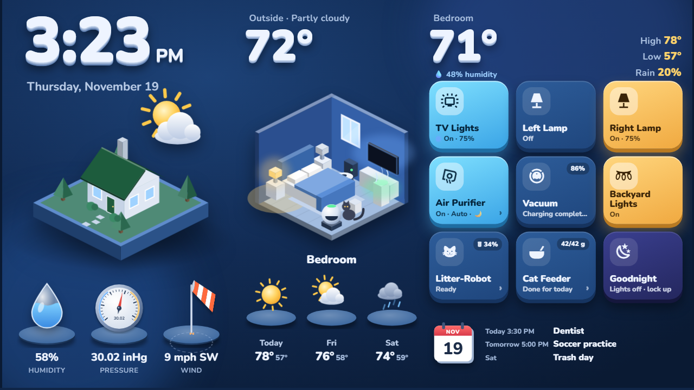

# Bedroom 3D Card (`bedroom3d-card`)



A touch dashboard for a bedroom screen such as a Nest Hub or a small tablet. It's designed on a 1280×720 canvas and scales to fit.

**What's on it**

- **Left side:** the clock, a little house with live weather, humidity/pressure/wind gauges and a 3-day forecast.
- **Middle:** a 3D bedroom that reacts to your devices:
  - the bedside lamps glow
  - the TV backlight takes the colour of your TV light strip
  - the air purifier spins, and its night light glows
  - the robot vacuum drives around while it's cleaning
  - the litter box turns while it's cycling
  - the cat bowl fills while the feeder is dispensing
- **Top right:** the room temperature and humidity, plus today's high, low and rain chance.
- **Nine tiles:**
  - TV lights, left lamp, right lamp and backyard lights toggle when tapped.
  - Vacuum: tap twice to start cleaning.
  - Goodnight: tap twice to run your goodnight script.
  - Air purifier, litter box and feeder open a big popup with their controls and stats.
- **Bottom right:** your next calendar events.

## Install

Copy [`cards/bedroom3d-card.js`](../cards/bedroom3d-card.js) to `/config/www/` and add `/local/bedroom3d-card.js` as a **JavaScript module** resource. Use a **Panel** view.

## Example

Only list the options you want to change. Everything else uses the defaults at the top of the file. A full example is in [examples/bedroom3d.yaml](../examples/bedroom3d.yaml).

```yaml
type: custom:bedroom3d-card
name: Main Bedroom
weather: weather.home
room_temp: sensor.bedroom_temperature
room_hum: sensor.bedroom_humidity
calendars:
  - calendar.family
lamp_left: light.bedside_left
lamp_left_name: Alex's Lamp
lamp_right: light.bedside_right
lamp_right_name: Sam's Lamp
tv_lights: light.tv_backlight
vac: vacuum.bedroom_vacuum
goodnight: script.goodnight
```

## Options

| Option | Default | What it is |
|---|---|---|
| `name` | `Bedroom` | Label under the 3D room |
| `weather` | `weather.home` | Any weather entity |
| `outside_temp` | weather's temperature | Optional outdoor temperature sensor |
| `sun` | `sun.sun` | Day/night effects |
| `room_temp`, `room_hum` | | Room temperature (`sensor.*` or `climate.*`) and humidity |
| `high`, `low`, `rain_chance` | | Optional sensors for today's high, low and rain chance |
| `calendars` | `[]` | `calendar.*` entities |
| `tv_lights` | | A `light.*`. Its colour tints the TV in the scene |
| `lamp_left`, `lamp_right` | | Bedside lamps (`light.*`) |
| `lamp_left_name`, `lamp_right_name` | `Left Lamp`, `Right Lamp` | Tile labels |
| `backyard`, `backyard_name` | | Any `switch.*` and its tile label |
| `purifier` | | `fan.*` for the air purifier |
| `purifier_speed`, `purifier_scene` | | `select.*` entities for speed and night-light scene |
| `purifier_nl` | | Purifier night light (`light.*`) |
| `purifier_aq`, `purifier_filter` | | Air quality and filter life sensors |
| `vac`, `vac_name` | | `vacuum.*` and its tile label |
| `vac_batt`, `vac_status`, `vac_area`, `vac_time` | | Vacuum sensors |
| `vac_segments` | `null` | Dreame vacuums only: room ids to clean, e.g. `[1, 2]`. Without it, the tile calls `vacuum.start` |
| `litter`, `litter_code`, `litter_drawer`, `litter_level`, `litter_weight`, `litter_globe` | | [Litter-Robot](https://www.home-assistant.io/integrations/litterrobot/) entities |
| `feeder_feeding`, `feeder_food`, `feeder_error`, `feeder_desiccant`, `feeder_dispensed`, `feeder_planned` | | Pet feeder entities (made for PETLIBRO feeders) |
| `feeder_manual` | | A `text.*` entity that triggers a manual feed |
| `feeder_schedule_template` | `null` | Optional Jinja template that returns today's meals as JSON (see below) |
| `goodnight` | `script.goodnight` | Script run by the Goodnight tile |

### Feeding schedule

The feeder popup can list today's meals. Feeders expose their schedules differently, so you provide a template that returns a JSON list:

```json
[{"t": "7:00 AM", "n": "Breakfast", "a": 2, "s": "done"},
 {"t": "6:00 PM", "n": "Dinner", "a": 2, "s": "next"}]
```

`t` is the time, `n` the meal name, `a` the portions, and `s` is `done`, `next` or `later`. Without a template, the tile shows "Food low!" or "Done for today" based on the feeder sensors.

## Tips

- Add `#pop=purifier` (or `vac`, `litter`, `feeder`) to the page URL to open a popup straight away. This is handy while you set it up.
- Popups close by themselves after 60 seconds.

[← back to all cards](../README.md)
