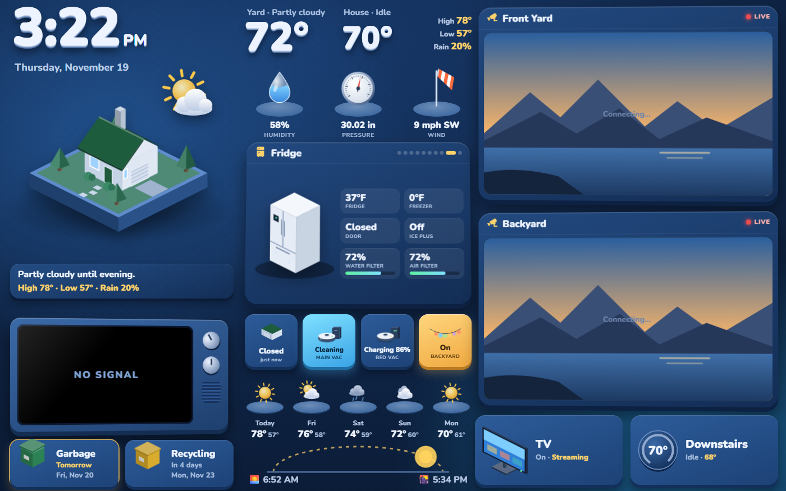

# Garage 3D Card (`garage3d-card`)



A display-only dashboard for a monitor on the garage wall. It's designed on a 1400×875 canvas (16:10) and scales to fit.

**What's on it**

- **Left:**
  - the clock
  - the house with live weather; its garage door opens and closes with yours
  - today's summary
  - a retro TV for a [WeatherStar 4000+](https://github.com/netbymatt/ws4kp) channel
  - garbage and recycling days
- **Middle:**
  - outside and house temperatures, plus gauges
  - a rotating appliance panel: fridge, washer/dryer, and two vacuums
  - status chips for the garage door, vacuums and backyard lights
  - a 5-day forecast and a sun arc
- **Right:** two live camera views, the TV's status (with its current source), and the thermostat.

The appliance panel follows an `input_select` with the options `fridge`, `washer`, `vacuum_main` and `vacuum_bedroom`. Set a second `input_select` (`mode`) to `network` to cover the left side with a network card. [examples/garage-panel-rotation.yaml](../examples/garage-panel-rotation.yaml) rotates both.

## Install

Copy [`cards/garage3d-card.js`](../cards/garage3d-card.js) to `/config/www/` and add `/local/garage3d-card.js` as a **JavaScript module** resource. Use a **Panel** view.

## Example

A full example is in [examples/garage3d.yaml](../examples/garage3d.yaml).

```yaml
type: custom:garage3d-card
weather: weather.home
house: climate.downstairs
garage: cover.garage_door
cams:
  - { entity: camera.driveway, name: Driveway }
  - { entity: camera.back_yard, name: Backyard }
fridge_name: Kitchen Fridge
fridge: number.refrigerator_fridge_temperature
freezer: number.refrigerator_freezer_temperature
vacs:
  vacuum_main: { e: vacuum.downstairs, p: sensor.downstairs_, name: Downstairs }
  vacuum_bedroom: { e: vacuum.upstairs, p: sensor.upstairs_, name: Upstairs }
tv: media_player.living_room_tv
tv_name: Living Room TV
```

## Options

| Option | What it is |
|---|---|
| `weather`, `outside_temp`, `sun` | Weather entity, optional outdoor sensor, sun |
| `house` | `climate.*` for the indoor temperature and the thermostat tile |
| `high`, `low`, `rain_chance`, `summary`, `summary_alt` | Optional weather sensors |
| `garage` | Garage door `cover.*` |
| `middle` | `input_select` for the appliance panel |
| `mode` | `input_select`. The network overlay shows while it is `network` |
| `fridge_name`, `fridge`, `freezer`, `fridge_door`, `water_filter`, `air_filter`, `ice_plus` | Fridge entities (made for LG ThinQ) |
| `washer`, `washer_sub`, `washer_left` | Washer state, sub-cycle and seconds remaining |
| `vacs` | Two vacuums: `e` is the vacuum, `p` is the prefix of its sensors (`<p>battery_level`, `<p>status`, `<p>cleaned_area`, `<p>cleaning_time`, `<p>filter_left`, `<p>main_brush_left`), plus a `name` |
| `lights` | Any `switch.*` shown as a chip |
| `tv`, `tv_name` | `media_player.*` and its label |
| `trash`, `recycle` | Sensors whose state is the next pickup date (`YYYY-MM-DD`) |
| `cams` | Two cameras: `{ entity, name }` |
| `weatherstar` | Optional URL for the retro TV screen |

## Tips

- On a Linux box with a monitor, `cage` (a kiosk Wayland compositor) running Chromium in `--kiosk` mode makes a good always-on garage screen. Turn on hardware video decoding so the two camera streams stay smooth.

[← back to all cards](../README.md)
