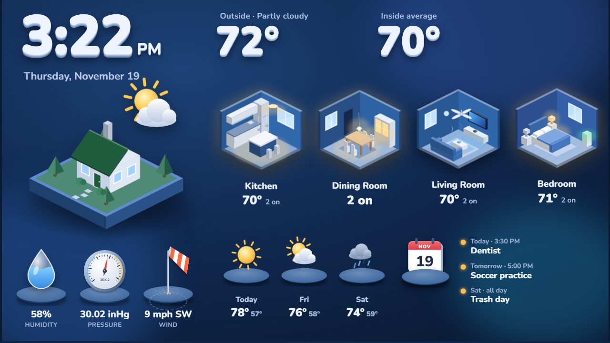

# Home 3D Card (`home3d-card`)



An animated, isometric "3D" dashboard card for Home Assistant. It is built for wall tablets, Nest Hubs and kiosk screens.

**What's on it**

- **Clock and date.** 12- or 24-hour.
- **The house.** A little house on a floating island. The weather plays above it: the sun's rays spin, clouds drift, and rain, snow, lightning or fog animate. At night the windows glow, and the chimney smokes when it's cold.
- **Gauges.** A raindrop fills to the humidity level, a barometer needle shows live pressure, and a 3D windsock turns with the wind direction and flaps harder in stronger wind.
- **Temperatures.** Outside, and an average of any indoor sensors or thermostats you choose.
- **Up to 4 rooms.** Each is a 3D isometric scene (kitchen, dining room, living room or bedroom) that reacts to your devices:
  - lights glow
  - the TV screen shimmers
  - the ceiling fan spins
  - the purifier night light glows
  - the thermostat light pulses orange when heating and blue when cooling
- **Room controls.** Tap a room for a big, touch-friendly popup. Dimmable lights get brightness sliders. Thermostats get heat/cool setpoint buttons and mode buttons. There's an optional "tap twice to restart" action, for example to power-cycle a streaming stick.
- **Bottom row.** A 3-day forecast with animated icons, a calendar page with today's date, and your next calendar events. If you have fewer than 3 events, it shows sunrise or sunset instead.

It's a single JavaScript file with no build step and no dependencies. It uses SVG and CSS, and it's designed on a 1280×720 canvas that scales to fit any screen.

---

## Install

1. Copy `cards/home3d-card.js` to `/config/www/home3d-card.js`.
2. Go to **Settings → Dashboards → ⋮ → Resources → Add resource**:
   - URL: `/local/home3d-card.js`
   - Type: **JavaScript module**
3. Create a dashboard. A **Panel** view works best, because the card fills the screen. Then add the card in YAML mode:

```yaml
type: custom:home3d-card
weather: weather.home
```

That's the minimum. Add rooms and the other options below.

**Tip:** after updating the file, change the resource URL to `/local/home3d-card.js?v=2` (then `v=3`, and so on) so browsers re-download it.

---

## Options

| Option | Default | Description |
|---|---|---|
| `weather` | **required** | Any `weather.*` entity. It provides the condition, humidity, pressure, wind and the daily forecast. |
| `outside_temp` | weather's temperature | Optional sensor for the big "Outside" number, such as your own outdoor thermometer. |
| `indoor` | `[]` | List of `climate.*` and/or `sensor.*` entities. Their average is shown as the indoor temperature. |
| `indoor_label` | `Inside average` | Label above the indoor temperature. |
| `calendars` | `[]` | List of `calendar.*` entities for the events list (next 10 days). |
| `sun` | `sun.sun` | Used for day/night effects and sunrise/sunset. |
| `roof_color` | `#1d5c3d` | Colour of the house roof. |
| `time_format` | `"12"` | `"12"` or `"24"`. |
| `locale` | `en-US` | Locale for dates and times, for example `en-GB` or `de-DE`. |
| `rooms` | `[]` | Up to 4 rooms (see below). |

### Rooms

```yaml
rooms:
  - name: Kitchen          # label under the tile and popup title
    scene: kitchen         # kitchen | dining | living | bedroom (the 3D drawing to use)
    temp_entity: climate.downstairs   # optional, a climate.* or sensor.*, shown on the tile
    items:                 # controls in the popup
      - entity: light.kitchen_ceiling
        name: Main Lights
        icon: mdi:ceiling-light
        role: main         # which part of the 3D scene this device animates (see below)
```

Item types:

- `light.*`, `switch.*` and `fan.*` toggle when tapped. Dimmable lights also get a brightness slider.
- `climate.*` shows a full-width thermostat panel.
- `action: restart` together with `script: script.your_script` makes the item "tap twice to run the script". This is useful for power-cycling something.

The tile under each room shows the temperature (if `temp_entity` is set) and how many devices are on.

### Scene roles

Each scene has a few "hot spots". Give an item a `role` and that part of the drawing reacts to it. Roles are optional. Items without a role still appear in the popup; they just don't animate the scene.

| Scene | Roles |
|---|---|
| `kitchen` | `main` (ceiling light and floor glow), `pendants` (island pendants), `strip` (under-cabinet LED strip) |
| `dining` | `chandelier`, `cabinet` (glass hutch lights up), `doorway` (light spilling in from the next room) |
| `living` | `tv` (screen shimmers), `fan` (ceiling fan spins), `thermostat` (wall thermostat shows heating/cooling) |
| `bedroom` | `lamp_left`, `lamp_right` (bedside lamps), `nightlight` (purifier night light glows green) |

---

## Full example

```yaml
type: custom:home3d-card
weather: weather.home
outside_temp: sensor.backyard_temperature
indoor:
  - climate.downstairs
  - climate.upstairs
calendars:
  - calendar.family
roof_color: "#1d5c3d"
rooms:
  - name: Kitchen
    scene: kitchen
    temp_entity: climate.downstairs
    items:
      - { entity: light.kitchen_ceiling, name: Main Lights, icon: mdi:ceiling-light, role: main }
      - { entity: light.kitchen_island, name: Island, icon: mdi:ceiling-light-multiple, role: pendants }
      - { entity: light.kitchen_strip, name: Strip, icon: mdi:led-strip-variant, role: strip }
  - name: Dining Room
    scene: dining
    items:
      - { entity: light.dining_chandelier, name: Chandelier, icon: mdi:chandelier, role: chandelier }
      - { entity: switch.china_cabinet, name: Cabinet, icon: mdi:dresser, role: cabinet }
      - { entity: light.kitchen_ceiling, name: Kitchen, icon: mdi:ceiling-light, role: doorway }
  - name: Living Room
    scene: living
    temp_entity: climate.downstairs
    items:
      - entity: switch.tv_stick_plug
        name: Streaming Stick
        icon: mdi:television-classic
        role: tv
        action: restart
        script: script.restart_streaming_stick
      - { entity: switch.ceiling_fan, name: Fan, icon: mdi:ceiling-fan, role: fan }
      - { entity: climate.downstairs, name: Thermostat, role: thermostat }
  - name: Bedroom
    scene: bedroom
    temp_entity: sensor.bedroom_temperature
    items:
      - { entity: light.bedside_left, name: Left Lamp, icon: mdi:lamp, role: lamp_left }
      - { entity: light.bedside_right, name: Right Lamp, icon: mdi:lamp, role: lamp_right }
      - { entity: light.purifier_night_light, name: Night Light, icon: mdi:air-purifier, role: nightlight }
```

An example restart script, used by `action: restart` above:

```yaml
alias: Restart streaming stick
sequence:
  - action: switch.turn_off
    target: { entity_id: switch.tv_stick_plug }
  - delay: { seconds: 10 }
  - action: switch.turn_on
    target: { entity_id: switch.tv_stick_plug }
```

---

## Tips

- **Nest Hub / Google display:**
  - Cast it with `cast.show_lovelace_view` (`dashboard_path`, `view_path`). It needs Home Assistant reachable over HTTPS, for example through Nabu Casa.
  - The Hub drops HA casts after about 10 minutes. An automation that re-casts every 8 minutes keeps it on screen; call `media_player.turn_off` first, then cast.
  - To silence the cast chime, mute the Hub (`media_player.volume_mute`) just before re-casting and unmute it a few seconds after.
- **Slow devices:**
  - Put a gzipped copy next to the file (`gzip -9 -k home3d-card.js`). HA serves `home3d-card.js.gz` automatically, and it's about 4× smaller.
  - Remember to re-gzip after every edit, or the old version keeps being served.
- **"Configuration error" for a second on load:** this is normal on slow screens. It shows while the file downloads, then the card appears.
- **Font:** the card loads *Nunito* from Google Fonts. If the screen has no internet, it falls back to a system font.
- **Popups:** they close by themselves after 60 seconds of no touches.

[← back to all cards](../README.md)
