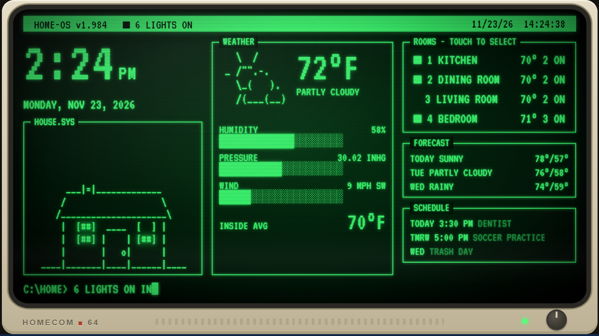
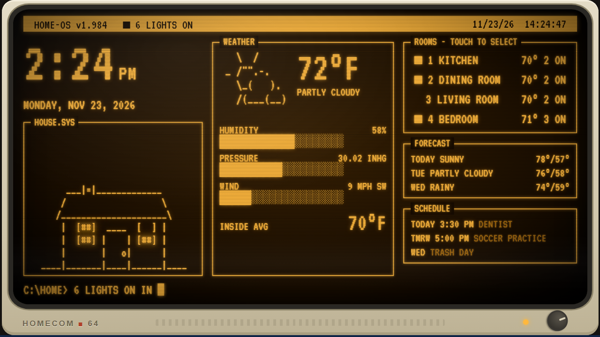

# Home 80s (`custom:home80-card`)

A home dashboard drawn as an 80s computer: a beige "HOMECOM 64" monitor, green or amber phosphor text, scanlines, a rolling refresh bar, flicker and a BIOS boot screen. It uses the same rooms and controls as [Home 3D](home3d-card.md), just in text mode.

## What's on screen

- **Status bar:** title, how many lights are on, date and time.
- **Clock and date.**
- **HOUSE.SYS:** an ASCII house. Each of the first four rooms owns a window, which shows `[##]` when a light in that room is on. Stars come out at night and the chimney smokes when it's below 50°F outside.
- **WEATHER:** ASCII weather art (rain and snow animate), temperature, condition, and bars for humidity, pressure and wind, plus the average inside temperature.
- **ROOMS:** tap a room to open its window. `■` means a light is on.
- **FORECAST:** 3 days, from `weather/subscribe_forecast`.
- **SCHEDULE:** the next calendar events, then sunset or sunrise.
- **Prompt:** `C:\HOME>` types rotating status messages.

## Room window

- `[X]` / `[ ]` toggles lights, switches and fans. Dimmable lights also get a 10-cell brightness bar you can tap.
- `climate.*` items get a thermostat panel: current temperature, -/+ setpoints (heat and cool in auto mode) and AUTO / HEAT / COOL / OFF.
- An item with `action: restart` and `script:` asks for a second tap, then runs the script. Handy for power-cycling a TV or streaming stick on a smart plug.
- The window closes by itself after 60 seconds.

## Options

| Option | Default | |
|---|---|---|
| `title` | `HOME-OS` | Status bar and boot screen name |
| `color` | `green` | `green` or `amber`. The knob on the bezel toggles it, and that choice is remembered per browser |
| `bezel` | `true` | `false` shows just the screen, edge to edge |
| `weather` | `weather.home` | Any weather entity |
| `outside_temp` | none | Optional sensor; otherwise the weather entity's temperature |
| `sun` | `sun.sun` | Day/night and sunset/sunrise |
| `indoor` | `[]` | `climate.*` entities averaged into INSIDE AVG |
| `calendars` | `[]` | `calendar.*` entities for SCHEDULE |
| `rooms` | 4 sample rooms | `name`, optional `temp_entity` (climate or sensor), and `items` (`entity`, `name`, optional `action: restart` + `script`) |

Temperatures are shown in °F and wind in MPH.

See [examples/home80.yaml](../examples/home80.yaml).

## Tips

- Use a **Panel** view. The card is a 1280×720 stage that scales to fit.
- Add `#noboot` to the URL to skip the boot screen, or `#room=1` to open a room on load (useful for screenshots).
- It loads the *VT323* font from Google Fonts.
