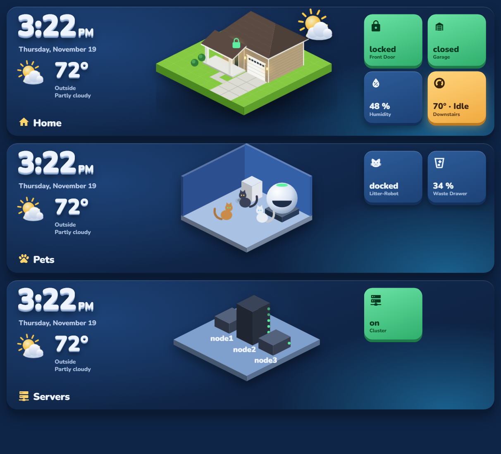
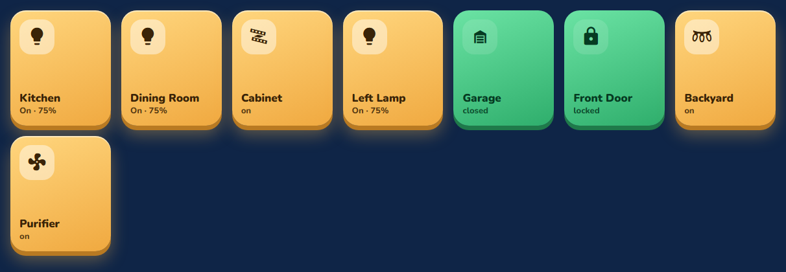

# Room 3D (`room3d-hero` and `room3d-tiles`)

One file, [`cards/room3d.js`](../cards/room3d.js), holds two cards that bring the 3D look to ordinary dashboards. Add `/local/room3d.js` as a **JavaScript module** resource. Both cards take the full width of a Sections view.

## room3d-hero



A banner for the top of a dashboard page. It shows the clock, the current weather, an animated 3D scene, a title, and up to four status chips. Tap a chip to open that entity's more-info dialog.

```yaml
type: custom:room3d-hero
scene: home
title: Home
icon: mdi:home
weather: weather.home
entities:
  garage: cover.garage_door
  porch_light: light.porch
  garage_lights: [light.garage_left, light.garage_right]
  lock: lock.front_door
stats:
  - { entity: lock.front_door, name: Front Door, good: [locked], bad: [unlocked, jammed] }
  - { entity: cover.garage_door, name: Garage, good: [closed] }
  - { entity: sensor.outdoor_humidity, name: Humidity, icon: mdi:water-percent }
  - { entity: climate.downstairs, name: Downstairs }
```

### Common options

| Option | Default | What it is |
|---|---|---|
| `scene` | **required** | One of the scenes below |
| `title`, `icon` | | Title and icon in the bottom left |
| `weather` | `weather.home` | Weather entity |
| `outside_temp` | weather's temperature | Optional outdoor sensor |
| `sun` | `sun.sun` | Night mode for the scenes |
| `stats` | `[]` | Status chips: `entity`, optional `name` and `icon`, and optional `good` / `bad` state lists that colour the chip green or red |
| `house_color`, `roof_color` | tan, brown | Colours of the house in the `home` and `garage` scenes |

### Scenes

| `scene` | What it draws | `entities` keys |
|---|---|---|
| `home` | A house on a lawn island. The garage door opens, the porch and garage lights glow, a lock badge shows on the door, and the chimney smokes when it's cold | `garage`, `porch_light`, `garage_lights` (list), `lock` |
| `garage` | The same house, zoomed in on the garage | same as `home` |
| `rooms` | Two 3D rooms side by side. Uses `rooms:` exactly like the [Home 3D card](home3d-card.md#rooms) (scenes `kitchen`, `dining`, `living`, `bedroom` with roles) | none; use `rooms:` |
| `office` | A desk whose two monitors glow when the TV/PC is on, plus a purifier and thermostat | `tv`, `nightlight`, `purifier`, `thermostat` |
| `shed` | A backyard shed with string lights and a mini-split AC | `power_probe` (list; any available = shed has power), `lights`, `string_lights`, `ac` |
| `outdoor` | A robot mower on the lawn, or in its dock when charging | `mower`, `mower_charging` |
| `appliances` | A big washer whose drum spins while it runs | `washer` (state `Run` = running) |
| `pets` | Three cats, a feeder and a Litter-Robot that turns while cycling | `feeding`, `food_level`, `litter_code` |
| `vacuums` | Two robot vacuums with their battery levels | `vacuums`: list of `{ name, entity, battery }` |
| `system` | A small server rack and mini PCs that light up when online | `nodes`: list of `{ name, kind: mini or rack, entity }` |
| `car` | A compact SUV with a lock badge. Its headlights glow and exhaust puffs while it's running. Set its colour with `car_color` | `lock`, `ignition`, `remote_start` |

Examples for every scene are in [examples/room3d-hero.yaml](../examples/room3d-hero.yaml).

## room3d-tiles



Big, chunky touch tiles that press down when tapped. Lights glow warm with their brightness, locks and covers turn green when secure, and dimmable lights get a slider.

```yaml
type: custom:room3d-tiles
entities:
  - { entity: light.kitchen_ceiling, name: Kitchen }
  - { entity: switch.china_cabinet, name: Cabinet, icon: mdi:led-strip-variant }
  - { entity: cover.garage_door, name: Garage }
  - { entity: lock.front_door, name: Front Door }
  - light.hallway
```

Each entry is an entity id or an object with:

| Key | What it is |
|---|---|
| `entity` | A `light`, `switch`, `fan`, `input_boolean`, `lock`, `cover` or `script` is toggled or run. Anything else opens the more-info dialog |
| `name`, `icon` | Optional label and icon |
| `confirm` | `true` = tap twice to act. Locks and covers always ask for a second tap |
| `tap` | `more-info` to open the dialog instead of toggling |

[← back to all cards](../README.md)
