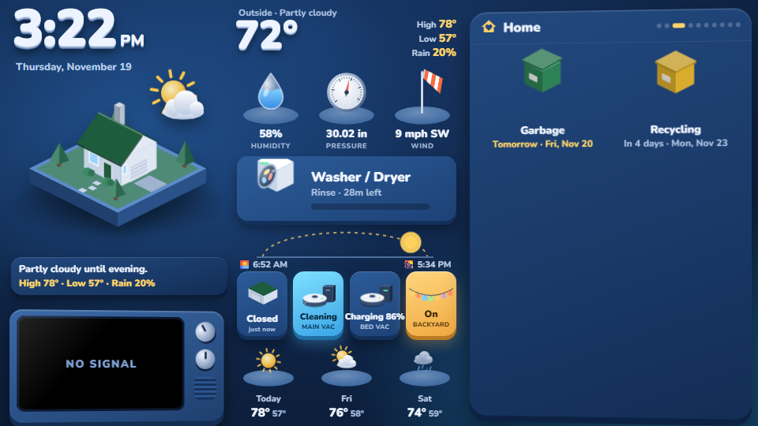

# TV 3D Card (`tv3d-card`)



A display-only dashboard for a TV, made for a Fire TV or Android TV running a kiosk browser. It's designed on a 960×540 canvas (a 1080p TV at 200% zoom) and scales to fit. Nothing needs to be tapped.

**What's on it**

- **Left:** clock, a house with live weather, today's summary, and a retro TV set. The TV can play a [WeatherStar 4000+](https://github.com/netbymatt/ws4kp) channel.
- **Middle:**
  - gauges for humidity, pressure and wind
  - wind, gusts, rain odds and rain today, swapped for a washer progress bar while the washer runs
  - a sun arc with sunrise and sunset
  - status chips for the garage door, two vacuums and the backyard lights
  - a 3-day forecast
- **Right:** a big panel that changes with an `input_select`. Rotate it with an automation, as in [examples/tv-panel-rotation.yaml](../examples/tv-panel-rotation.yaml).

| Panel key | Shows |
|---|---|
| `photos` | An `image.*` entity, with a slow Ken Burns zoom and cross-fade |
| `camera` | Live view of each camera in `cams` |
| `home` | Garbage and recycling day, and an optional pet feeding plan |
| `mower` | Robot mower state, battery and stats |
| `vacuum_main`, `vacuum_bedroom` | An embedded vacuum card |
| `network` | An embedded network card |
| `tv_shows` | Upcoming events from `calendars` (for example a Sonarr calendar) |

The input_select's options decide which panels appear, and in what order. You can add your own panels with `embeds`.

## Install

Copy [`cards/tv3d-card.js`](../cards/tv3d-card.js) to `/config/www/` and add `/local/tv3d-card.js` as a **JavaScript module** resource. Use a **Panel** view.

## Example

A full example is in [examples/tv3d.yaml](../examples/tv3d.yaml).

```yaml
type: custom:tv3d-card
weather: weather.home
panel: input_select.tv_display_panel
photo: image.photo_frame
cams:
  - camera.front_yard
  - camera.back_yard
garage: cover.garage_door
vac_main: vacuum.downstairs
vac_bed: vacuum.upstairs
lights: switch.backyard_lights
washer: sensor.washer_machine_state
trash: sensor.next_trash_pickup
recycle: sensor.next_recycling_pickup
calendars:
  - calendar.sonarr
embeds:
  network:
    - type: entities
      entities: [sensor.speedtest_download, sensor.speedtest_upload]
```

## Options

| Option | What it is |
|---|---|
| `weather`, `outside_temp`, `sun` | Weather entity, optional outdoor sensor, sun |
| `high`, `low`, `rain_chance`, `rain_today`, `wind`, `gust` | Optional weather sensors |
| `summary`, `summary_alt` | Text sensors for today's summary; the second is used if the first is empty |
| `panel` | The `input_select` that picks the right panel |
| `photo` | `image.*` entity for the Photos panel |
| `cams` | List of camera entities for the Cameras panel |
| `garage` | Garage door `cover.*` |
| `vac_main`, `vac_main_batt`, `vac_main_name` | First vacuum, its battery sensor and name |
| `vac_bed`, `vac_bed_batt`, `vac_bed_name` | Second vacuum |
| `lights` | Any `switch.*` shown as a chip |
| `washer`, `washer_sub`, `washer_left` | Washer state (the panel shows while it's `Run`), sub-cycle and time remaining in seconds. Made for LG ThinQ |
| `trash`, `recycle` | Sensors whose state is the next pickup date (`YYYY-MM-DD`) |
| `calendars` | `calendar.*` entities for the TV Shows panel |
| `feeder_schedule_template` | Optional feeding plan for the Home panel. Same format as the [Bedroom card](bedroom3d-card.md#feeding-schedule) |
| `mower`, `mower_battery`, `mower_charging`, `mower_mode`, `mower_next_start`, `mower_error`, `mower_cutting_time`, `mower_drive_distance`, `mower_charging_cycles`, `mower_charging_time` | Robot mower entities (made for Husqvarna Automower) |
| `embeds` | `{ panel_key: [card config, ...] }`. Replaces or adds embedded panels |
| `weatherstar` | Optional URL for the retro TV screen |

## Tips

- In Fully Kiosk Browser, set the zoom so the page is 960×540 CSS pixels. On a 1080p TV that's 200%.
- To test one panel in a browser, add `?panel=camera` to the demo page URL.

[← back to all cards](../README.md)
